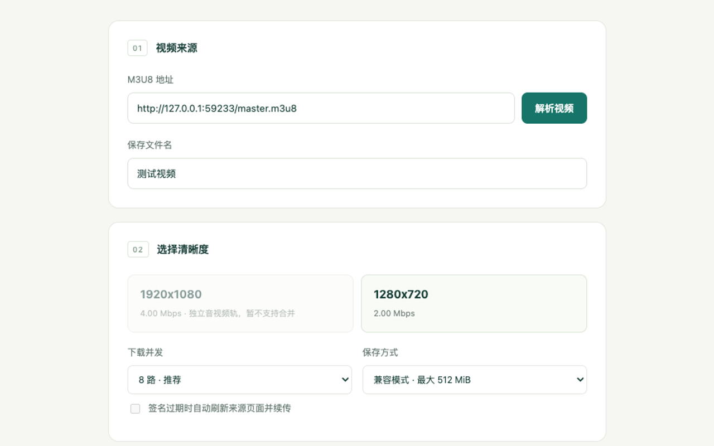

# 流存 · M3U8 视频下载

无需构建、无需服务器的 Manifest V3 Chrome 扩展。发现当前页面的 HLS 视频，选择清晰度，并发下载并按顺序保存为一个文件。

[下载安装包](https://github.com/MurphyWhite/VideoDownload/releases/latest) · [反馈问题](https://github.com/MurphyWhite/VideoDownload/issues) · [隐私政策](PRIVACY.md)

## 1.1.1 修复

某些 CDN 的 `token_path` 只写资产目录，实际媒体地址前面还有日期目录。现在会识别并限制在完整资产目录内，把签名传给清晰度列表、分片与密钥；仍不跨域或跨资产复用签名。

## 1.1.0 更新

- 默认 8 路并发，可选 4 / 8 / 12 路；显示本次运行的平均写入速度。网站限速和网络情况仍决定实际速度。
- 支持本页内暂停、失败后续传；保留已完成的顺序前缀及当前窗口中已下载的分片，避免一次 403 就从零开始。
- 对携带 `token`、`expires`、`token_path` 的目录签名，401 / 403 后从成功捕获的新请求中获取新签名。多个失败请求共享一次续签流程。
- 从弹窗打开的任务默认允许在签名失效时重新加载来源页面，用户可取消勾选。仅刷新原来源域名的标签页；该页已切换网站则不自动刷新。新签名等待最多 2 分钟，超时保留本页进度。
- 默认使用 Chrome 文件选择器指定一个文件，分批直接写入磁盘，完成后提交保存，避免长视频积累成大 Blob。该模式没有 512 MiB 的文件大小上限。兼容内存模式仍限制 512 MiB。

1.0.1 修复了签名目录内的相对播放列表、分片、初始化分片和密钥丢失鉴权参数的问题。签名仅在同域、完全相同的规范目录范围内传播和更新；不复制无关查询字段、不跨域传递、不覆盖子资源自己的独立签名。扩展无法自行伪造或延长服务器签名。

## 本地安装

1. 在 [Releases](https://github.com/MurphyWhite/VideoDownload/releases/latest) 下载 `liucun-m3u8-1.1.1.zip`，或下载仓库源码 ZIP。
2. 将 ZIP 解压到一个固定目录；Chrome 需要持续读取该目录，请不要安装后删除它。
3. 使用 Chrome 120 或更高版本，打开 `chrome://extensions`。
4. 开启右上角的 **开发者模式（Developer mode）**，点击 **加载已解压的扩展程序（Load unpacked）**。
5. 选择直接包含 `manifest.json` 的解压目录，在工具栏固定“流存”。无需 npm install 或打包命令。

GitHub 下载包采用本地加载方式安装；不支持将 ZIP 直接拖入 Chrome 自动安装，也不会通过 Chrome 网上应用店自动更新。

已经安装本项目的用户，在扩展卡片点击“重新加载”即可更新。更新会关闭旧扩展工作台；旧版本已经丢弃的下载数据无法恢复。



界面示例使用本地合成播放列表，不包含真实用户视频或签名令牌。

## 使用方式

1. 刷新视频网页并播放视频，点击“流存”。徽标数字表示该标签页发现的播放列表数量，一个视频的主列表和子列表可能分别出现。
2. 点击一个视频源，在新工作台中选择清晰度。也可以手动粘贴 HTTP / HTTPS m3u8 地址（无后缀列表也可解析）。
3. 选择并发数和保存方式。长视频建议“直接写入磁盘”。如网站容易限速或返回 429，可改为 4 路。
4. 点击下载，在 Chrome 的文件选择器中指定保存位置。磁盘模式开始前选择文件；兼容模式在下载完毕后显示 Chrome 下载保存对话框。
5. 保持工作台标签页打开。点击“暂停”后，在同一工作台点击“继续下载”即可续传。
6. 签名失效时，保留来源页面。勾选自动刷新可由扩展重新加载该页面；如果播放器必须点击播放才产生新请求，请手动播放。扩展发现同一资产的新签名后继续下载。
7. 若续签等待超时，刷新来源页并播放，再回到原工作台点击“继续下载”。不要新开工作台重做任务。
8. “放弃当前任务并清除续传进度”会终止文件写入并释放进度，之后可重新解析或更改保存方式。

**续传仅在当前工作台生命周期内有效。** 关闭或重新加载该页、重启浏览器、扩展更新都会丢失任务状态。磁盘模式使用浏览器的文件写入事务，完成并关闭写入流后才提交文件；暂停中的文件不保证可播放，放弃或关闭可能留下空占位文件。

原视频页面需保持可用才能获取新签名。手动输入地址没有绑定来源标签页，不能自动刷新来源页，但仍能使用浏览器捕获到的同一资产新签名。网站若更换资源路径、签名格式或要求专用授权，可能无法自动恢复。

## 支持范围与限制

| 项目 | 支持情况 |
| --- | --- |
| 已结束点播列表（EXT-X-ENDLIST） | 支持；不录制直播 |
| 主列表、多清晰度、相对 URL、重定向 | 支持，按最终列表地址解析 |
| MPEG-TS | 按顺序保存为 `.ts`，不冒充 MP4 |
| 固定 EXT-X-MAP 的 fMP4 | 初始化分片加媒体片段，保存为 `.mp4` |
| 普通 AES-128 CBC | 支持显式 IV、媒体序号 IV 和列表提供的密钥 |
| EXT-X-BYTERANGE | 验证 HTTP 206、Content-Range 和响应长度 |
| 并发与重试 | 4 / 8 / 12 路；网络错误、超时、429 / 5xx 最多尝试 3 次；单次请求含响应体超时 30 秒 |
| 签名失效 | 同域同签名目录更新令牌，等待最多 2 分钟，保留进度 |
| 任务大小 | 磁盘模式无 512 MiB 内存文件上限；兼容模式最多 512 MiB |
| 暂停续传 | 当前工作台内有效；不支持关闭页后恢复 |
| DRM、SAMPLE-AES、独立音视频轨 | 暂不支持 |
| 时间线切换、缺失分片、初始化分片变更 | 暂不支持，需要重新封装 |
| 纯 AAC / MP3、M2TS / 非标准 TS | 暂不支持 |
| 字幕、转码、跨浏览器重启的恢复 | 暂不支持 |

最多 10,000 个分片、单资源最多 64 MiB、播放列表最多 2 MiB。磁盘写入只保留有限并发窗口的媒体数据；内存峰值仍受并发数、单片大小、解密临时数据和浏览器实现影响。多个工作台会累加资源占用。

不会重新封装或转码。播放器仍需支持源编解码器；复杂 fMP4 可能需要外部工具处理。基础媒体标识检查不能替代完整解码验证。

请求使用 `credentials: 'include'`，由浏览器按网站 Cookie 策略携带登录凭据。扩展不读取 Cookie，也不重放页面的 Authorization、Referer 或自定义头。防盗链、Cookie 限制、POST 播放列表或页面专用认证仍可能导致 401 / 403。仅下载有权保存的内容。

## 权限说明（供 Chrome Web Store 审核）

| manifest 声明 | 用途、触发时机与必要性 |
| --- | --- |
| `activeTab` | 用户点击扩展时读取当前页标题、URL 和 ID，展示页面及绑定来源，避免申请所有标签页敏感信息的 `tabs` 权限。 |
| `scripting` | 打开弹窗或重新扫描时执行本地 content.js，读取媒体元素、链接与资源记录，补充之前已加载的地址；无持续内容脚本。 |
| `storage` | storage.session 中按页保存最多 80 个发现结果，页面重新加载或关闭时清理。已发现网络请求也用于寻找同一资产的新签名。 |
| `webRequest` | 观察 HTTP(S) 响应 URL、状态码、Content-Type，识别 m3u8 / HLS MIME 列表并按标签页分类；不读取响应体、不拦截或修改请求。 |
| `downloads` | 兼容内存模式下保存用户主动下载的 Blob，并观察完成/中断以释放资源或允许重新保存。磁盘模式使用文件选择器，只写用户选择的单个文件，不新增扩展权限。 |
| `host_permissions`: `http://*/*`、`https://*/*` | 页面、iframe、播放列表、分片和密钥可能位于未知的跨域 CDN。这些范围用于自动发现 HLS、读取用户选择的资源。webRequest 需要同时具有发起页和资源主机权限。限制网站访问范围会使相应检测/请求不可用。 |

未声明可选权限，也未申请 `cookies`、`debugger`、`webRequestBlocking`、`offscreen`、`tabs`、`unlimitedStorage` 等权限。来源页刷新使用已有 tabs API 的基本操作，且只允许 HTTP(S) 页面与原绑定域名一致的标签页。

## 数据与安全

- 无统计、外部 LLM、远程代码或上传服务；媒体请求只面向所选列表、分片、密钥及服务器重定向。
- URL 可能含签名令牌，仅放在扩展会话存储及工作台 URL 片段/输入框中，不要公开含签名的地址和截图。
- 文件句柄、下载前缀和当前窗口缓存只在工作台内存保留；完成或放弃后释放。不把文件句柄持久保存到扩展存储。
- 自动刷新只向原来源页重新发起正常页面加载，不调用第三方续签服务。不能获取新签名时暂停，不绕过授权。
- 后台只接受本扩展 UI 的已知消息，校验字段、协议、刷新目标域名和签名范围。不声明 externally_connectable 或 web_accessible_resources，不提供网页可调用的任意请求代理。
- 页面文本通过 textContent 展示，无 eval、内联扩展脚本、远程可执行代码或硬编码密钥。

## 文件结构

```text
manifest.json        MV3、入口与权限
background.js        网络发现、会话缓存、最新签名查询与来源页刷新
content.js           用户触发的页面扫描
popup.html/js        当前页视频列表和来源绑定
download.html/js    工作台、并发、文件选择、暂停续传与保存
lib/hls.js           解析器、URL / 签名范围 / IV / 文件名
lib/downloader.js    有界请求、解密、并发窗口、顺序写入和任务状态
lib/auth.js          多请求共享的签名续期等待与隔离
styles.css、icons/   本地界面及图标
tests/               单元、HTTP、UI 与真实扩展手动验证工具
AGENTS.md            开发规范
TESTING.md           已执行验证及边界
```

## 测试与调试

安装 Node.js 22+ 后运行 `npm test`，不需要其他依赖。测试监听本机回环地址，使用合成 TS / fMP4 字节验证请求、解密、顺序、续传和错误；这些合成字节不是可播放视频。已执行测试见 [TESTING.md](TESTING.md)。

开发者可使用 `python3 scripts/package_store.py` 生成仅含运行文件的 ZIP；此命令仅在本地打包，不上传或收费。源码中的 `store/`、`dist/` 和 `artifacts/` 由 Git 忽略。

手动验收：真实点播页发现 → 清晰度选择 → 选择文件 → 下载中暂停再继续 → 签名过期后获取新签名 → 完成保存 → 播放器核对画面、声音、时长和拖动。还应检查不同网站认证、跨域 iframe、429 / 403、磁盘空间不足、关闭来源页和工作台等情况。

可运行 `node tests/manual-fixture-server.mjs`，打开输出的本机 `/watch` 地址，通过扩展弹窗下载合成列表。测试源首次在第 8 个分片后拒绝旧令牌；工作台应刷新来源页并继续完成。仅用于管线验证，输出不是可播放媒体。

修改源码后在 `chrome://extensions` 重新加载扩展，并重开工作台。正在运行的任务会丢失状态，更新前先完成或放弃。

- 后台：扩展卡片的 Service Worker 检查视图。
- 弹窗：打开后右键“检查”。
- 工作台：该页 DevTools 的 Console / Network。
- 内容脚本：来源页 DevTools 的 Sources → Content scripts。
- 加载问题：扩展卡片的“错误”。

## 参考

- [Chrome webRequest](https://developer.chrome.com/docs/extensions/reference/api/webRequest)
- [Chrome downloads](https://developer.chrome.com/docs/extensions/reference/api/downloads)
- [扩展跨域请求](https://developer.chrome.com/docs/extensions/develop/concepts/network-requests)
- [File System Access API](https://developer.chrome.com/docs/capabilities/web-apis/file-system-access)
- [RFC 8216：HTTP Live Streaming](https://www.rfc-editor.org/rfc/rfc8216)

## 联系与支持

支持邮箱：[white@ditto.rocks](mailto:white@ditto.rocks)。

提交问题时请说明 Chrome 版本、扩展版本、错误提示和复现步骤。不要发送登录 Cookie、签名令牌、完整私人视频地址或私人媒体文件。

数据处理说明见 [隐私政策](PRIVACY.md)，提交问题前可查看 [支持说明](SUPPORT.md)。

本仓库暂未指定开源许可证。
